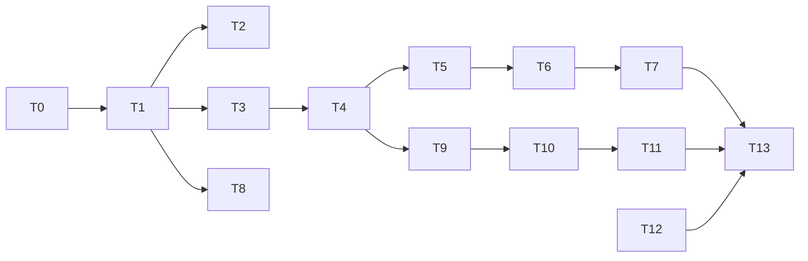

# JalanITku — Breakdown Produksi Bertahap dengan AI

> Tujuan dokumen ini: agar saat website di-generate oleh AI per tahap, hasilnya **konsisten, rapi, dan sesuai brief**.
> Dokumen pendamping: `JalanITku-Planning-Sistem.md` (sumber kebenaran untuk fitur, alur, dan keputusan final).
>
> **Revisi terbaru:** satu pengguna hanya punya 1 JalanID + 1 Cocoklogiku (1 role); berbagi lewat gambar/dokumen (tanpa halaman publik/link); konten Indonesia dulu (Inggris menyusul); soal JalanRapor pilihan ganda semua.

---

## 1. Prinsip Agar Hasil AI Tetap Konsisten

| # | Prinsip | Alasannya |
|---|---|---|
| 1 | **Satu tahap = satu sesi/prompt terfokus.** Jangan minta "buatkan seluruh website". | AI kehilangan detail jika scope terlalu besar |
| 2 | **Selalu mulai dengan konteks tetap** (Master Context, bagian 3) | Mencegah AI mengubah gaya, nama, atau struktur antar sesi |
| 3 | **Kunci hal yang tidak boleh berubah** dalam file: design tokens, skema database, struktur folder, kontrak API | AI cenderung "berimprovisasi" jika tidak dikunci |
| 4 | **Bangun fondasi dulu** (tokens, komponen UI, i18n, skema data) sebelum halaman | Halaman berikutnya cukup *memakai* komponen, bukan membuat gaya baru |
| 5 | **Setiap tahap punya Definition of Done** yang dapat dicek | Mencegah tahap dianggap selesai padahal setengah jadi |
| 6 | **Commit per tahap**, buat tag git, dan jangan lanjut sebelum DoD terpenuhi | Mudah rollback jika AI merusak tahap sebelumnya |
| 7 | **Larang AI mengubah file di luar scope tahap** | Mencegah regresi diam-diam |
| 8 | **Minta AI menyebut asumsi** sebelum menulis kode | Salah paham ketahuan di awal |
| 9 | **Aset berulang dibuat sebagai sistem** (mascot = komponen + data, soal = file seed), bukan satuan | Konsistensi untuk 19 role |
| 10 | **Review visual per tahap** (screenshot) dengan checklist neo-brutalism | Gaya visual paling mudah melenceng |

---

## 2. Struktur Repo & File Konteks (Dibuat di Tahap 0)

Buat file-file ini sekali, lalu **sertakan/rujuk di setiap prompt**.

```
jalanitku/
├─ docs/
│  ├─ PROJECT_BRIEF.md        ← ringkasan produk + keputusan final (dari dokumen planning)
│  ├─ DESIGN_SYSTEM.md        ← tokens, aturan komponen, checklist neo-brutalism
│  ├─ DATA_SCHEMA.md          ← skema database final
│  ├─ API_CONTRACT.md         ← endpoint, request/response
│  ├─ CONTENT_GUIDE.md        ← aturan penulisan soal, tone bahasa, format multi-bahasa (id dulu)
│  └─ PROGRESS.md             ← log tahap yang selesai + catatan keputusan
├─ src/
│  ├─ app/                    ← halaman / routing
│  ├─ components/
│  │  ├─ ui/                  ← komponen dasar neo-brutalism (Button, Card, Input, ...)
│  │  ├─ mascot/              ← komponen mascot per role
│  │  └─ features/            ← komponen khusus fitur
│  ├─ lib/                    ← scoring, anti-bot, util
│  ├─ i18n/                   ← id.json (en.json menyusul)
│  └─ data/seed/              ← roles, competencies, soal (JSON)
└─ scripts/                   ← validasi soal, seed, generator
```

> **Aturan emas:** setiap tahap berakhir dengan memperbarui `docs/PROGRESS.md` (apa yang dibuat, file apa yang berubah, keputusan yang diambil).

---

## 3. Master Context (Tempel di Awal Setiap Sesi AI)

```text
Kamu sedang membangun website "JalanITku" secara bertahap.

RINGKASAN
JalanITku membantu orang IT yang bingung memilih karier. 3 fitur:
A. JalanKarir -> hasil kartu "JalanID" (role IT yang cocok)
B. JalanRapor -> hasil rapor "Cocoklogiku" (seberapa cocok dengan role pilihan)
C. JalanLoker -> lowongan kerja (DITUNDA, jangan dibangun kecuali diminta)

ATURAN WAJIB
- Bahasa UI & konten: HANYA Indonesia untuk saat ini (default, tanpa pemilih bahasa). Semua teks tetap lewat i18n (tidak boleh ada teks hardcode) agar Inggris bisa menyusul tanpa refaktor.
- Login hanya Google OAuth + pilih username unik (bisa diubah kapan saja).
- Gaya visual: Neo-brutalism (border hitam tebal, hard shadow tanpa blur, warna jenuh, tipografi tebal).
- Logo: text logo "JalanITku", bagian "IT" tampil berbeda dan mencolok.
- Gratis penuh. Tidak ada leaderboard, tidak ada sertifikat, tidak ada batas waktu soal.
- Tes boleh diulang tanpa batas; tampilkan peringatan "hasil sebelumnya akan hilang".
- Satu pengguna hanya punya 1 JalanID dan 1 Cocoklogiku (1 role). Tes ulang / ganti role menimpa hasil lama (UNIQUE user_id, upsert).
- JalanID & Cocoklogiku dibagikan sebagai GAMBAR/DOKUMEN (PNG/PDF). TIDAK ada halaman publik, link share, QR ke halaman publik, atau toggle privasi.
- Semua soal JalanRapor berupa pilihan ganda (4–5 opsi, 1 jawaban benar).
- Kunci jawaban & bobot role TIDAK PERNAH dikirim ke klien.

CARA KERJA
1. Baca docs/PROJECT_BRIEF.md, DESIGN_SYSTEM.md, DATA_SCHEMA.md, API_CONTRACT.md sebelum menulis kode.
2. Kerjakan HANYA scope tahap yang saya sebutkan. Jangan ubah file di luar scope.
3. Gunakan komponen di components/ui. Jangan membuat gaya baru di luar design tokens.
4. Sebutkan asumsi dan hal yang tidak jelas SEBELUM menulis kode.
5. Di akhir: daftar file yang dibuat/diubah, cara menjalankan/menguji, dan checklist Definition of Done (centang satu per satu).
6. Perbarui docs/PROGRESS.md.
```

---

## 4. Design Tokens (Kunci di `DESIGN_SYSTEM.md`)

> Nilai berikut adalah usulan awal. Setelah disepakati, **jangan diubah antar tahap**.

### 4.1 Warna

| Token | Hex | Penggunaan |
|---|---|---|
| `--ink` | `#0A0A0A` | Border, teks utama, shadow |
| `--paper` | `#FFF8E7` | Latar halaman (krem) |
| `--white` | `#FFFFFF` | Latar kartu |
| `--yellow` | `#FFD60A` | Aksen utama, **"IT" pada logo** |
| `--pink` | `#FF5C8A` | Aksen sekunder |
| `--blue` | `#3D5AFE` | Aksi/tautan |
| `--green` | `#2EE59D` | Sukses/positif |
| `--orange` | `#FF8A3D` | Peringatan/aksen |
| `--purple` | `#9B5CFF` | Aksen tambahan |
| `--danger` | `#FF3B3B` | Error / peringatan hasil hilang |

### 4.2 Bentuk, Border, Shadow

| Token | Nilai |
|---|---|
| `--border` | `3px solid var(--ink)` |
| `--border-thick` | `4px solid var(--ink)` |
| `--radius` | `0px` (default) / `8px` (maksimum untuk elemen kecil) |
| `--shadow-sm` | `3px 3px 0 var(--ink)` |
| `--shadow-md` | `6px 6px 0 var(--ink)` |
| `--shadow-lg` | `10px 10px 0 var(--ink)` |
| Hover tombol | translate `(-2px, -2px)`, shadow membesar |
| Active tombol | translate `(+4px, +4px)`, shadow hilang |

### 4.3 Tipografi

| Peran | Font |
|---|---|
| Heading / Logo | Space Grotesk atau Archivo Black (bold/black) |
| Body | Inter atau DM Sans |
| Aksen teknis | JetBrains Mono |

Skala: 12 / 14 / 16 / 20 / 28 / 40 / 56 / 72 px.

### 4.4 Logo
- Susunan: `Jalan` + `[ IT ]` + `ku`.
- "Jalan" dan "ku": hitam, font heading.
- "IT": di dalam kotak `--yellow`, border `--border-thick`, `--shadow-sm`, sedikit dimiringkan (misal `-3deg`), ukuran sedikit lebih besar.
- Dibuat sebagai **komponen `<Logo />`** (SVG/React), bukan gambar acak per halaman.

### 4.5 Checklist Neo-Brutalism (dipakai di tiap review visual)
- [ ] Semua kartu/tombol/input punya border hitam tebal
- [ ] Shadow keras tanpa blur
- [ ] Tidak ada gradient halus, glassmorphism, atau shadow blur
- [ ] Warna dari token saja
- [ ] Kontras teks memenuhi WCAG AA
- [ ] Ada state hover, active, focus, dan disabled
- [ ] Tampilan nyaman di layar 360px (mobile-first)
- [ ] Animasi menghormati `prefers-reduced-motion`

---

## 5. Peta Tahap Produksi

| Tahap | Nama | Memetakan ke Fase di Planning | Estimasi Sesi AI |
|---|---|---|---|
| T0 | Fondasi proyek | Fase 0 | 2–3 |
| T1 | Design system & komponen UI | Fase 0–1 | 3–4 |
| T2 | Landing page | Fase 1 | 2–3 |
| T3 | Autentikasi & profil | Fase 1 | 2–3 |
| T4 | Data layer & seed role | Fase 1 | 2 |
| T5 | Bank soal JalanKarir | Fase 1 | 3–4 |
| T6 | Engine & UI JalanKarir | Fase 1 | 3–4 |
| T7 | JalanID (kartu, unduh, bagikan) | Fase 1 | 2–3 |
| T8 | Sistem mascot | Fase 1–3 | 4–6 (bertahap) |
| T9 | Bank soal JalanRapor | Fase 2 | 10+ (per role) |
| T10 | Engine & UI JalanRapor | Fase 2 | 3–4 |
| T11 | Cocoklogiku (rapor hasil) | Fase 2 | 3–4 |
| T12 | Anti-bot & keamanan | Fase 1–3 | 2–3 |
| T13 | Polish, QA, deploy | Fase 3 | 3–4 |
| T14 | JalanLoker | Fase 4 (ditunda) | — |
| T15 | Bahasa Inggris (menyusul) | Setelah rilis stabil | 4–6 |

> **Urutan penting:** T0 → T1 → T4 harus selesai sebelum fitur. T8 (mascot) dikerjakan paralel/bertahap dan **tidak memblokir** T6–T11 (gunakan placeholder dulu).



---

## 6. Detail Tiap Tahap

Format tiap tahap: **Tujuan → Deliverable → Prompt → Definition of Done → Jangan Dilakukan**.

---

### T0 — Fondasi Proyek

**Tujuan:** menyiapkan kerangka teknis dan dokumen konteks.

**Deliverable**
- Repo + struktur folder (bagian 2), TypeScript, linting, formatter, CI dasar.
- Setup framework (usulan: Next.js + Tailwind + PostgreSQL + ORM).
- Setup **i18n** dengan locale default `id` (tanpa pemilih bahasa; struktur siap menambah `en`).
- Semua file `docs/*` terisi (PROJECT_BRIEF, DESIGN_SYSTEM, DATA_SCHEMA, API_CONTRACT, CONTENT_GUIDE, PROGRESS).

**Prompt**
```text
[Tempel Master Context]

TAHAP: T0 — Fondasi Proyek.
1. Buat struktur repo sesuai bagian 2 dokumen breakdown.
2. Setup Next.js (App Router) + TypeScript + Tailwind + ESLint + Prettier.
3. Setup i18n dengan locale default "id" saja (tanpa deteksi browser dan tanpa tombol ganti bahasa). Semua teks lewat file terjemahan (id.json); struktur harus memungkinkan menambah en.json kelak tanpa refaktor.
4. Setup koneksi database PostgreSQL + ORM, belum ada tabel fitur.
5. Isi docs/PROJECT_BRIEF.md dari dokumen planning (termasuk keputusan final).
6. Tuliskan DESIGN_SYSTEM.md dengan token di bagian 4.
7. Tuliskan DATA_SCHEMA.md (tabel: users, roles, competencies, career_questions, question_role_weights, career_sessions, career_answers, jalan_ids, rapor_questions, rapor_sessions, rapor_answers, cocoklogiku) dengan konten tampil disimpan ekstensibel untuk banyak bahasa (misal kolom JSON `{ "id": "..." }`; hanya "id" yang terisi sekarang, "en" menyusul). Tambahkan UNIQUE(user_id) pada jalan_ids dan cocoklogiku (satu hasil aktif per pengguna, upsert saat tes ulang). Tidak ada kolom is_public/kode_publik.
8. Tuliskan API_CONTRACT.md sesuai rancangan API di dokumen planning.
Jangan buat halaman fitur apa pun. Sebutkan asumsi dulu.
```

**Definition of Done**
- [ ] `npm run dev`, `lint`, dan `build` sukses
- [ ] Semua teks halaman uji berasal dari id.json; menambah bahasa baru hanya perlu menambah file terjemahan
- [ ] Semua file `docs/*` ada dan terisi
- [ ] Skema data final dan sudah disetujui
- [ ] `PROGRESS.md` diperbarui

**Jangan:** membuat UI fitur, memilih library tambahan di luar stack tanpa alasan.

---

### T1 — Design System & Komponen UI

**Tujuan:** semua halaman berikutnya hanya "merakit" komponen yang sudah ada.

**Deliverable** (di `components/ui`)
`Logo`, `Button` (varian: primary/secondary/danger/ghost; ukuran), `Card`, `Input`, `Select`, `Radio/Choice card` (untuk opsi a–e), `LikertScale` (1–5), `ProgressBar`, `Badge`, `Modal/Dialog` (untuk peringatan), `Toast`, `Tabs`, `Navbar`, `Footer`, `Skeleton/Loading`, `EmptyState`. *(LanguageSwitcher ditunda sampai Bahasa Inggris tersedia.)*
Plus halaman **/dev/components** (galeri semua komponen dan state-nya).

**Prompt**
```text
[Tempel Master Context]

TAHAP: T1 — Design System & Komponen UI.
Baca docs/DESIGN_SYSTEM.md. Buat komponen di components/ui sesuai daftar:
Logo, Button, Card, Input, Select, ChoiceCard, LikertScale, ProgressBar, Badge, Dialog, Toast, Tabs, Navbar, Footer, Skeleton, EmptyState.
- Semua warna/border/shadow dari token (CSS variables/Tailwind config).
- Setiap komponen punya state: default, hover, active, focus-visible, disabled.
- Logo: "IT" dalam kotak kuning, berbeda & mencolok sesuai DESIGN_SYSTEM.
- Buat halaman /dev/components yang memajang semua komponen + state-nya (hanya untuk development).
- Responsif 360px ke atas, aksesibel (keyboard, aria).
Jangan buat halaman produk.
```

**Definition of Done**
- [ ] Semua komponen tampil di `/dev/components`
- [ ] Lolos checklist neo-brutalism (bagian 4.5)
- [ ] Tidak ada warna/shadow di luar token
- [ ] Dapat dioperasikan dengan keyboard
- [ ] Screenshot galeri sudah direview dan disetujui

**Jangan:** menambahkan gaya baru di halaman; setiap kebutuhan gaya baru harus lewat komponen.

---

### T2 — Landing Page

**Deliverable:** halaman publik sesuai bagian 5 dokumen planning (Hero, Masalah, 3 Fitur, Cara Kerja, Galeri Mascot placeholder, Contoh JalanID, FAQ, Footer), Bahasa Indonesia, SEO meta + Open Graph untuk landing page.

**Prompt**
```text
[Tempel Master Context]

TAHAP: T2 — Landing Page.
Bangun landing page publik hanya dengan komponen components/ui.
Bagian: Hero (Logo + tagline + CTA "Mulai"), Masalah, 3 Fitur (JalanKarir, JalanRapor, JalanLoker berlabel "Segera Hadir"), Cara Kerja (4 langkah), Galeri Mascot (placeholder kotak berwarna per role), Contoh JalanID (mock statis), FAQ (accordion), Footer.
- Semua teks lewat i18n (id.json). Tulis copy Bahasa Indonesia yang ramah, santai, dan relevan untuk anak IT.
- Semua CTA mengarah ke /login.
- Mobile-first, animasi masuk ringan, hormati prefers-reduced-motion.
- SEO: title, description, Open Graph.
```

**Definition of Done**
- [ ] Tampil sempurna di 360px, 768px, 1280px
- [ ] Seluruh teks Bahasa Indonesia lewat i18n, tanpa teks hardcode
- [ ] JalanLoker jelas berlabel "Segera Hadir"
- [ ] Lighthouse: Performance ≥ 90, Accessibility ≥ 95
- [ ] Lolos checklist neo-brutalism

---

### T3 — Autentikasi & Profil

**Deliverable:** Login Google (OAuth), onboarding username, middleware proteksi rute, dashboard dasar (3 kartu fitur), halaman profil (ubah username, hapus akun), logout.

**Prompt**
```text
[Tempel Master Context]

TAHAP: T3 — Autentikasi & Profil.
- Google OAuth (Auth.js atau setara). Pengguna baru WAJIB melewati halaman pilih username sebelum mengakses fitur apa pun.
- Validasi username: unik (case-insensitive), 3–20 karakter, huruf/angka/underscore/titik, filter kata terlarang, cek ketersediaan real-time (debounce).
- Username BOLEH diubah kapan saja (tetap unik); username lama dilepas.
- Middleware: rute /karir, /rapor, /loker, /dashboard, /profil butuh login + username.
- Dashboard: 3 kartu fitur (JalanLoker nonaktif "Segera Hadir").
- Profil: ubah username dan hapus akun (dengan konfirmasi dan penghapusan data). Tidak ada toggle privasi, pemilih bahasa, atau halaman profil publik.
- Jangan simpan data Google selain yang dibutuhkan (sub, email, nama, avatar).
```

**Definition of Done**
- [ ] Login → onboarding username → dashboard berjalan end-to-end
- [ ] Pengguna tanpa username tidak dapat membuka rute terproteksi
- [ ] Ubah username berfungsi dan menjaga keunikan
- [ ] Hapus akun menghapus seluruh data terkait
- [ ] Email tidak pernah tampil di halaman publik

---

### T4 — Data Layer & Seed Role

**Deliverable:** migrasi database final, seed **19 role** (slug, nama, deskripsi, warna, ikon; Bahasa Indonesia), seed **kompetensi per role** (5–7 kompetensi), repository/service layer.

**Prompt**
```text
[Tempel Master Context]

TAHAP: T4 — Data layer & seed role.
- Buat migrasi sesuai DATA_SCHEMA.md.
- Seed 19 role: Software Engineer, Mobile Developer, Game Developer, Quality Assurance, IT Support, Network Engineer, Cloud Engineer, DevOps Engineer, Data Analyst, Data Scientist, Data Engineer, AI/ML Engineer, Security Analyst, UI/UX Designer, Digital Forensics, Project Manager, Business Analyst, Data Entry, IT Consultant.
- Setiap role: slug, nama, deskripsi (apa yang dikerjakan sehari-hari), warna (dari token), mascot_key. Teks disimpan ekstensibel multi-bahasa; hanya "id" yang diisi sekarang.
- Seed 5–7 kompetensi per role (nama dalam Bahasa Indonesia) yang akan menjadi sumbu radar chart di Cocoklogiku.
- Buat service: getRoles(), getRoleBySlug(), getCompetencies(roleId).
- Tulis test sederhana untuk seed dan service.
```

**Definition of Done**
- [ ] 19 role dan semua kompetensi ter-seed dalam Bahasa Indonesia
- [ ] Seed idempotent (aman dijalankan ulang)
- [ ] Tes lulus
- [ ] Halaman sementara `/dev/roles` menampilkan semua role

---

### T5 — Bank Soal JalanKarir

**Tujuan:** menghasilkan bank soal berkualitas, **diproduksi oleh sistem** lewat pipeline.

**Spesifikasi konten**
- 5 level × **±25 soal** = ±125 soal (tampil 10/level).
- Level: (1) Minat Umum, (2) Gaya Kerja, (3) Skenario, (4) Ketertarikan Teknis, (5) Prioritas Karier.
- Tipe: skala 1–5 atau preferensi a–e.
- Setiap soal: `teks` dan `opsi` dalam Bahasa Indonesia (disimpan ekstensibel multi-bahasa), **bobot ke 19 role** (−1…+3), tag kategori.
- Tidak ada jawaban benar/salah; netral, tidak menggiring.
- Distribusi bobot seimbang agar tidak ada role yang selalu menang.

**Prompt (Generator, per level)**
```text
[Tempel Master Context + docs/CONTENT_GUIDE.md]

TAHAP: T5 — Bank soal JalanKarir, LEVEL {N} ({tema}).
Hasilkan 25 soal dalam JSON sesuai skema di DATA_SCHEMA.md.
Aturan:
- Bahasa Indonesia yang natural, tidak menggurui, tidak menggiring.
- Tipe campuran: skala 1–5 dan preferensi a–e (hanya jika level mendukung).
- Setiap soal memiliki bobot ke 19 role (−1 s/d +3). Bobot harus masuk akal secara karier. Jelaskan alasan bobot singkat di field "rationale" (tidak ditampilkan ke pengguna).
- Cakupan: setiap role harus dibobot positif tinggi (≥2) pada minimal 4 soal di level ini.
- Hindari duplikasi makna; variasikan gaya kalimat (untuk anti-scraping, sediakan 2 variasi redaksi per soal di field "variants").
Keluarkan HANYA JSON valid.
```

**Prompt (Validator / Script)**
```text
Buat scripts/validate-career-questions.ts yang memeriksa: skema valid, teks (Bahasa Indonesia) tidak kosong, bobot dalam rentang, semua 19 role terwakili tiap level, tidak ada duplikat (kemiripan teks), jumlah soal per level ≥ 25, dan melaporkan "bias role" (role yang total bobotnya jauh di atas/bawah rata-rata). Keluarkan laporan.
```

**Definition of Done**
- [ ] 5 level × ≥25 soal ter-seed
- [ ] Validator lulus tanpa error; laporan bias dalam batas wajar
- [ ] Uji simulasi: 1.000 jawaban acak → distribusi role tidak didominasi 1–2 role
- [ ] Spot-check manual 20 soal acak (kealamian bahasa & kewajaran bobot)

---

### T6 — Engine & UI JalanKarir

**Deliverable:** alur tes 5 level, scoring engine, soal adaptif tambahan, pengacakan, halaman hasil sementara.

**Prompt**
```text
[Tempel Master Context]

TAHAP: T6 — Engine & UI JalanKarir.
Backend (lib/karir):
- startSession: buat sesi + seed acak; ambil 10 soal acak/level (seimbang), urutan soal & opsi diacak, gunakan ID sementara per sesi (bukan ID DB).
- Soal level berikutnya dikirim hanya setelah level sebelumnya selesai.
- Scoring: skor_role = Σ(nilai_jawaban × bobot); persen = skor / skor_maks_role × 100. Skala 1–5 dinormalisasi (−2…+2). Bobot TIDAK dikirim ke klien.
- Adaptif: jika selisih Top-N role ≤ 3 poin setelah level 5, pilih 5 soal tambahan dengan daya pembeda tertinggi untuk role yang seri; maksimal 3 ronde. Jika tetap seri, hasil hibrida.
- Unit test untuk scoring, tie-break, dan pengacakan.
Frontend (/karir):
- Halaman mulai (dengan peringatan "hasil sebelumnya akan hilang" jika sudah pernah punya JalanID, via Dialog).
- Halaman tes: 1 soal per layar atau kelompok kecil, progress bar & indikator level, LikertScale/ChoiceCard, simpan progres otomatis (bisa lanjut).
- Transisi level yang menarik (neo-brutalism).
- Halaman hasil sementara (role utama + Top 3 + persen); kartu JalanID final dikerjakan di T7.
```

**Definition of Done**
- [ ] Alur end-to-end berjalan, termasuk lanjut sesi yang terputus
- [ ] Dua sesi pengguna yang sama menghasilkan soal/urutan berbeda
- [ ] Soal tambahan aktif saat skor seri (diuji dengan data sintetis)
- [ ] Respons jaringan tidak memuat bobot/kunci
- [ ] Unit test lulus
- [ ] Mengulang tes menimpa hasil lama setelah konfirmasi

---

### T7 — JalanID (Kartu, Unduh, Bagikan)

**Deliverable:** komponen kartu JalanID, render ke PNG (3 rasio: kartu, 1:1, 9:16) dan PDF, halaman hasil pribadi (wajib login), tombol unduh dan bagikan file (Web Share API dengan file gambar). **Tanpa halaman publik dan tanpa link share.**

**Prompt**
```text
[Tempel Master Context]

TAHAP: T7 — JalanID.
- Komponen <JalanIDCard />: Logo, username, role utama + placeholder mascot (key: mascot_key), persen kecocokan Top 1, 2 role sekunder, tagline role (Bahasa Indonesia), tanggal terbit, kode kartu unik (teks biasa sebagai penanda, BUKAN link/QR ke halaman publik). Gaya neo-brutalism, warna dominan mengikuti warna role.
- Render server-side ke PNG (satori/@vercel/og atau Puppeteer) dalam 3 rasio: kartu, 1:1, 9:16, plus ekspor PDF.
- Halaman hasil /karir/hasil: hanya untuk pengguna yang login, menampilkan JalanID miliknya. TIDAK ada rute publik /id/{username}, tidak ada Open Graph per pengguna, tidak ada toggle privasi.
- Tombol: Unduh PNG (3 rasio), Unduh PDF, dan Bagikan via Web Share API dengan FILE gambar (fallback: unduh saja jika perangkat tidak mendukung).
- Mengganti username tidak boleh memengaruhi kartu lama yang sudah dibagikan (kartu hanya gambar).
- Satu pengguna = satu JalanID aktif; hasil baru menimpa yang lama (upsert).
- Jangan menampilkan email atau data pribadi lain pada kartu.
```

**Definition of Done**
- [ ] PNG terunduh sesuai 3 rasio dan terbaca jelas
- [ ] PDF terunduh rapi dan satu halaman
- [ ] Tombol Bagikan membagikan file gambar di perangkat yang didukung, dan ada fallback yang jelas
- [ ] Tidak ada rute publik, link share, atau data pribadi yang bocor pada kartu
- [ ] Kartu tampil benar untuk setiap dari 19 role (uji dengan data dummy)
- [ ] Teks panjang tidak merusak layout (uji username 20 karakter)

---

### T8 — Sistem Mascot (Bertahap)

**Tujuan:** 19 mascot 2D abstrak + animasi khas, konsisten satu keluarga visual.

**Strategi konsistensi**
1. Tetapkan dulu **Mascot Spec** (dikunci): ukuran viewBox (misal 200×200), aturan bentuk (hanya kotak, lingkaran, segitiga, garis tebal), border hitam 3px, 1 warna dominan role + 1–2 aksen dari token, struktur wajah sederhana (mata + opsional mulut), state: `idle`, `hover`, `happy`, `neutral`, `encourage`.
2. Buat **1 mascot acuan** (misal Software Engineer) → disetujui → jadikan template.
3. Sisanya dibuat **per batch 3–4 mascot** dengan acuan template dan Mascot Spec.
4. Animasi memakai CSS/SVG/Framer Motion lewat **API komponen yang sama**: `<Mascot role="data-analyst" state="idle" size={160} />`.

**Prompt (Spec + Acuan)**
```text
[Tempel Master Context]

TAHAP: T8a — Mascot Spec & Acuan.
Buat docs/MASCOT_SPEC.md (aturan di atas) dan komponen <Mascot role state size />.
Buat mascot "software-engineer" sebagai acuan: SVG 2D abstrak berbentuk blok kode { } dengan mata, border 3px hitam, warna kuning-aksen, 5 state animasi (idle, hover, happy, neutral, encourage). Buat halaman /dev/mascots untuk melihat semua state. Dukung prefers-reduced-motion.
```

**Prompt (Batch)**
```text
[Tempel Master Context + docs/MASCOT_SPEC.md]

TAHAP: T8b — Mascot batch {nama-role-1, role-2, role-3}.
Ikuti MASCOT_SPEC.md dan gaya mascot acuan "software-engineer" persis (ketebalan garis, gaya mata, proporsi).
Konsep per role: {lihat tabel konsep mascot di dokumen planning}.
Setiap mascot: 5 state animasi, animasi khas role pada state "idle", daftar di registry mascot, tampil di /dev/mascots.
Jangan mengubah mascot yang sudah ada.
```

**Rencana Batch**

| Batch | Role |
|---|---|
| 8a | Spec + Software Engineer (acuan) |
| 8b | Mobile Dev, Game Dev, QA, IT Support |
| 8c | Network, Cloud, DevOps, Data Analyst |
| 8d | Data Scientist, Data Engineer, AI/ML, Security |
| 8e | UI/UX, Digital Forensics, Project Manager, Business Analyst |
| 8f | Data Entry, IT Consultant + integrasi ke Landing, JalanID, Cocoklogiku |

**Definition of Done (per batch)**
- [ ] Gaya identik dengan mascot acuan (garis, proporsi, palet)
- [ ] Setiap mascot punya animasi khas dan 5 state
- [ ] Mudah dibedakan satu sama lain (uji tampil berjajar di `/dev/mascots`)
- [ ] Ringan (per mascot < 15 KB)
- [ ] Reduced motion didukung

---

### T9 — Bank Soal JalanRapor (Per Role)

**Tujuan:** soal teknis berkualitas untuk 19 role × 5 level, **dibuat sistem**, Bahasa Indonesia, pilihan ganda.

**Spesifikasi per role**
- 5 level × ±20 soal = ±100 soal/role (tampil 10/level).
- Level: 1 Dasar, 2 Pemula, 3 Menengah, 4 Lanjut, 5 Ahli.
- Tipe: **pilihan ganda saja** (4–5 opsi, tepat 1 jawaban benar). Soal skenario/studi kasus tetap boleh, tetapi bentuknya pilihan ganda. Tidak ada benar/salah terpisah, multi-jawaban, isian, atau soal kode.
- Setiap soal: tag **kompetensi** (untuk radar chart), poin, penjelasan jawaban (Bahasa Indonesia), kunci jawaban.
- Total: ±1.900 soal (Bahasa Indonesia saja untuk saat ini).

**Pipeline (wajib, agar kualitas konsisten)**
```
generate (per role-level) → validasi skema → cek duplikasi → cek keselarasan level
→ cek distribusi kompetensi → cek kunci jawaban (verifikasi ulang oleh pass kedua) → seed
```

**Prompt (Generator per role-level)**
```text
[Tempel Master Context + docs/CONTENT_GUIDE.md]

TAHAP: T9 — Soal JalanRapor, ROLE {role}, LEVEL {n} ({Dasar/Pemula/Menengah/Lanjut/Ahli}).
Kompetensi role ini: {daftar kompetensi dari seed}.
Hasilkan 20 soal JSON sesuai skema rapor_questions:
- Pilihan ganda 4–5 opsi, Bahasa Indonesia natural (istilah teknis baku boleh tetap Inggris), akurat secara teknis, tanpa ambiguitas, tepat SATU kunci benar.
- Tingkat kesulitan sesuai level {n}; level 1–2 konsep dasar, level 4–5 analisis kasus & trade-off.
- Setiap soal ditag 1–2 kompetensi; sebar merata minimal 3 soal per kompetensi.
- Distraktor masuk akal (bukan jelas salah), panjang opsi seimbang (jangan jawaban benar selalu paling panjang), posisi kunci acak.
- Sertakan penjelasan jawaban 1–3 kalimat (Bahasa Indonesia).
- Hindari soal yang bergantung pada versi/tool yang cepat usang.
Keluarkan HANYA JSON valid.
```

**Prompt (Verifier pass kedua)**
```text
Kamu verifier. Untuk setiap soal berikut, jawab sendiri tanpa melihat kunci, bandingkan dengan kunci. Tandai soal yang: kunci salah/ambigu, ada >1 jawaban benar, level tidak sesuai, bahasa tidak natural atau membingungkan. Keluarkan daftar soal bermasalah beserta alasan dan perbaikan.
```

**Rencana Batch (rilis bertahap)**

| Rilis | Role |
|---|---|
| R1 | Software Engineer, Data Analyst, UI/UX Designer, Network Engineer, Quality Assurance |
| R2 | Mobile Dev, Cloud, DevOps, Data Scientist, Data Engineer |
| R3 | AI/ML, Security Analyst, IT Support, Business Analyst, Project Manager |
| R4 | Game Dev, Digital Forensics, Data Entry, IT Consultant |

Role yang belum punya bank soal ditandai **"Segera Hadir"** di pemilihan role JalanRapor.

**Definition of Done (per role)**
- [ ] 5 level × ≥20 soal pilihan ganda, Bahasa Indonesia
- [ ] Verifier tidak menemukan soal bermasalah (atau sudah diperbaiki)
- [ ] Setiap kompetensi tercakup di setiap level
- [ ] Posisi kunci jawaban tersebar merata (tidak bias ke satu opsi)
- [ ] Spot-check manual 15 soal acak

---

### T10 — Engine & UI JalanRapor

**Prompt**
```text
[Tempel Master Context]

TAHAP: T10 — Engine & UI JalanRapor.
Backend (lib/rapor):
- startSession(role): hanya role yang bank soalnya tersedia; seed acak per sesi.
- Ambil 10 soal acak per level (5 level), urutan soal & opsi diacak, ID sementara; prioritaskan soal yang belum pernah muncul bagi pengguna ini.
- Level berikutnya hanya dikirim setelah level sebelumnya dikirim jawabannya.
- Penilaian di SERVER; kunci tidak pernah dikirim ke klien. Poin berbobot per level (L1=1, L2=1.5, L3=2, L4=2.5, L5=3). Catat skor per kompetensi.
- Satu hasil aktif per PENGGUNA (bukan per role): mengulang tes atau memilih role lain menimpa hasil lama (upsert, UNIQUE user_id). Tidak ada riwayat.
Frontend (/rapor):
- Pemilihan role (grid kartu role dengan mascot placeholder; role tanpa soal "Segera Hadir"; saran role dari JalanID jika ada).
- Dialog peringatan jika pengguna sudah punya hasil (role yang sama maupun role lain): "Hasil sebelumnya akan hilang". Halaman JalanRapor menampilkan role aktif pengguna + tombol "Ganti role".
- Halaman tes: tanpa timer, progress per level, simpan progres otomatis, bisa lanjut.
- Tipe soal: pilihan ganda saja (satu jawaban dipilih per soal).
Unit test untuk penilaian & pengacakan.
```

**Definition of Done**
- [ ] 50 soal per sesi (5×10) dan berbeda antar sesi
- [ ] Tidak ada kunci/penjelasan di respons sebelum sesi selesai
- [ ] Tidak ada timer di UI
- [ ] Mengulang menimpa hasil lama setelah konfirmasi
- [ ] Test lulus

---

### T11 — Cocoklogiku (Rapor Hasil)

**Prompt**
```text
[Tempel Master Context]

TAHAP: T11 — Cocoklogiku.
Halaman rapor berisi:
1. Ringkasan: role + mascot (state sesuai hasil), username, tanggal, nilai akhir (0–100), label (Belum Cocok <40 / Cukup Cocok 40–59 / Cocok 60–79 / Sangat Cocok ≥80).
2. Nilai per level (bar chart 5 level).
3. Radar chart skor per kompetensi role (sumbu dari seed kompetensi).
4. "Reason": narasi Bahasa Indonesia (template disimpan ekstensibel untuk bahasa lain) yang menjelaskan kekuatan, kelemahan, dan alasan label; dibangkitkan dari aturan/template berdasarkan data skor (kompetensi tertinggi/terendah, level di mana performa turun) — deterministik, bukan teks acak.
5. Rekomendasi: 3–5 topik belajar prioritas berdasarkan kompetensi terlemah (dari tabel rekomendasi per kompetensi di data seed), dan saran role alternatif berdasarkan pola skor + hasil JalanKarir.
6. Aksi: unduh PNG/PDF, bagikan sebagai gambar/dokumen (Web Share API dengan file; TANPA link publik), tes ulang atau ganti role (dengan peringatan hasil hilang), tinjau pembahasan soal yang salah dari tes aktif.
TIDAK ADA leaderboard/persentil/perbandingan antar pengguna dan TIDAK ADA sertifikat.
Gaya neo-brutalism; chart memakai warna token.
```

**Definition of Done**
- [ ] Radar chart akurat terhadap data skor (diuji dengan data sintetis)
- [ ] Narasi Reason relevan dan berbeda untuk profil skor berbeda, dalam Bahasa Indonesia
- [ ] PDF/PNG terunduh rapi
- [ ] Tampil baik di mobile (radar chart terbaca)
- [ ] Tidak ada elemen perbandingan antar pengguna

---

### T12 — Anti-Bot & Keamanan

**Prompt**
```text
[Tempel Master Context]

TAHAP: T12 — Anti-bot & keamanan.
- Rate limiting per akun & per IP (Redis) pada: mulai sesi, ambil soal, kirim jawaban, cek username.
- Captcha tak terlihat (Turnstile/reCAPTCHA v3) pada mulai sesi dan finish.
- Token sesi bertanda tangan + masa berlaku; satu sesi aktif per akun per fitur.
- Deteksi anomali: waktu jawab terlalu seragam/cepat, pola jawaban identik berulang, banyak sesi dari IP sama -> tandai sesi (flag), jangan blokir keras tanpa alasan; sesi ber-flag dicatat untuk ditinjau (hasil tetap tampil ke pengguna yang sah).
- Pastikan tidak ada endpoint yang mengembalikan seluruh bank soal; audit semua respons untuk kebocoran kunci/bobot.
- Header keamanan (CSP, HSTS), CSRF, cookie aman, validasi input.
- Tulis tes keamanan: coba scraping berulang, coba kirim jawaban di luar urutan, coba akses sesi pengguna lain.
```

**Definition of Done**
- [ ] Scraping berulang terblokir/terbatasi
- [ ] Tidak bisa mengakses/menjawab sesi milik pengguna lain
- [ ] Tidak ada kunci/bobot di Network tab pada alur normal
- [ ] Sesi anomali ter-flag di log

---

### T13 — Polish, QA, Deploy

**Checklist**
- [ ] Audit i18n: tidak ada teks hardcode, tidak ada kunci terjemahan hilang
- [ ] Audit visual: seluruh halaman lolos checklist neo-brutalism
- [ ] Aksesibilitas: WCAG AA, navigasi keyboard, pembaca layar
- [ ] Performa: LCP < 2,5 dtk, bundle terkontrol, gambar/aset dioptimasi
- [ ] SEO landing page: sitemap, robots, meta, Open Graph (tanpa halaman publik per pengguna)
- [ ] Error page (404/500), empty state, loading state
- [ ] Kebijakan Privasi & Syarat Layanan (Bahasa Indonesia), consent sesuai UU PDP
- [ ] Observabilitas (Sentry), backup database
- [ ] Uji end-to-end (Playwright) untuk 3 alur utama: login+username, JalanKarir→JalanID, JalanRapor→Cocoklogiku
- [ ] Beta test tertutup dan perbaikan

> Domain dan merek dagang diurus belakangan; siapkan konfigurasi domain sebagai variabel lingkungan agar mudah dipindah.

---

### T14 — JalanLoker (Ditunda)

Tidak dikerjakan sekarang. Siapkan hanya: kartu "Segera Hadir" di dashboard dan landing, serta tabel/rute yang dicadangkan pada `API_CONTRACT.md`. Detail ada di bagian 9 dokumen planning.

---

### T15 — Bahasa Inggris (Menyusul)

**Tujuan:** menambah Bahasa Inggris setelah produk berjalan stabil dalam Bahasa Indonesia.

**Deliverable:** `en.json` untuk seluruh UI, terjemahan seluruh role/kompetensi/soal/penjelasan, komponen `LanguageSwitcher`, preferensi bahasa tersimpan di `users.locale`, dan tag `hreflang` pada landing page.

**Prompt**
```text
[Tempel Master Context]

TAHAP: T15 — Bahasa Inggris.
1. Buat en.json lengkap dari id.json (kunci identik, tidak ada yang hilang).
2. Terjemahkan seed role, kompetensi, soal JalanKarir, soal JalanRapor, dan penjelasan ke Bahasa Inggris per batch, mengisi kunci "en" pada kolom multi-bahasa. Pertahankan makna, tingkat kesulitan, dan kunci jawaban; jangan ubah bobot atau kunci.
3. Tambahkan LanguageSwitcher (komponen ui) dan simpan pilihan di users.locale.
4. Jalankan skrip verifikasi: setiap entri punya "id" dan "en", tidak ada teks kosong, pilihan jawaban setara antar bahasa.
Jangan mengubah logika scoring.
```

**Definition of Done**
- [ ] Tidak ada kunci i18n yang hilang di en.json
- [ ] Seluruh soal dan penjelasan memiliki terjemahan setara (kunci jawaban identik)
- [ ] Pergantian bahasa berfungsi dan tersimpan
- [ ] Landing page memiliki `hreflang`

---

## 7. Template Prompt Perbaikan (Saat Hasil AI Melenceng)

**Gaya visual melenceng**
```text
Hasil ini melanggar DESIGN_SYSTEM.md: {sebutkan: ada shadow blur / warna di luar token / border tipis}.
Perbaiki hanya file {…} dengan memakai komponen & token yang ada. Jangan ubah file lain.
```

**AI mengubah hal yang sudah selesai**
```text
Kamu mengubah {file/fitur} yang di luar scope tahap ini. Kembalikan perubahan itu. Scope tahap ini hanya: {…}. Tunjukkan diff yang tersisa.
```

**Hasil tidak konsisten antar halaman**
```text
Bandingkan halaman {A} dan {B}. Cari ketidakkonsistenan (spasi, ukuran font, gaya tombol, bahasa). Seragamkan dengan komponen components/ui; laporkan perbedaan yang kamu temukan sebelum memperbaiki.
```

**Konten soal bermasalah**
```text
Berikut {N} soal yang bermasalah dan alasannya: {…}. Perbaiki hanya soal tersebut, pertahankan id-nya, lalu jalankan ulang validator.
```

---

## 8. Ringkasan Urutan Kerja yang Disarankan

1. **T0 → T1** — fondasi dan komponen (jangan dilewati).
2. **T2 → T3 → T4** — landing, login, data.
3. **T5 → T6 → T7** — JalanKarir lengkap sampai JalanID (**rilis MVP pertama**, dengan mascot placeholder).
4. **T8 batch demi batch** — mascot dikerjakan sambil jalan.
5. **T9 (R1) → T10 → T11** — JalanRapor untuk 5 role pertama (**rilis kedua**).
6. **T9 (R2–R4)** — tambah role bertahap.
7. **T12 → T13** — keamanan, polish, deploy.
8. **T14** — JalanLoker kelak.
9. **T15** — Bahasa Inggris, setelah semuanya stabil.

> Jika waktu terbatas: MVP minimum = T0–T7 (JalanKarir + JalanID) + T12 sebagian. JalanRapor dan mascot lengkap menyusul.

---

*Dokumen ini hidup: perbarui `PROGRESS.md` dan dokumen ini setiap kali ada keputusan atau perubahan scope.*
