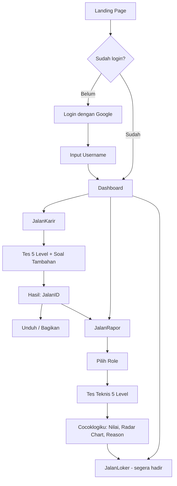
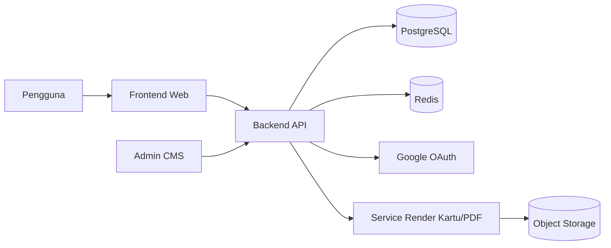
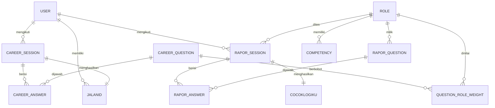

# JalanITku — Dokumen Planning Sistem

> Platform untuk membantu teman-teman IT yang masih bingung harus terjun ke dunia kerja sebagai apa.

| Item | Detail |
|---|---|
| Nama Produk | **JalanITku** |
| Versi Dokumen | 1.0 (Draft Planning) |
| Tanggal | 9 Oktober 2026 |
| Status | Perencanaan |
| Gaya Desain | Neo-brutalism |

---

## Daftar Isi

1. [Ringkasan Produk](#1-ringkasan-produk)
2. [Tujuan & Target Pengguna](#2-tujuan--target-pengguna)
3. [Gambaran Fitur](#3-gambaran-fitur)
4. [Alur Pengguna (User Flow)](#4-alur-pengguna-user-flow)
5. [Landing Page](#5-landing-page)
6. [Autentikasi & Profil](#6-autentikasi--profil)
7. [Fitur A — JalanKarir → JalanID](#7-fitur-a--jalankarir--jalanid)
8. [Fitur B — JalanRapor → Cocoklogiku](#8-fitur-b--jalanrapor--cocoklogiku)
9. [Fitur C — JalanLoker (Tahap Lanjut)](#9-fitur-c--jalanloker-tahap-lanjut)
10. [Bank Soal & Manajemen Konten](#10-bank-soal--manajemen-konten)
11. [Desain & Branding](#11-desain--branding)
12. [Arsitektur & Tech Stack (Usulan)](#12-arsitektur--tech-stack-usulan)
13. [Model Data](#13-model-data)
14. [Rancangan API](#14-rancangan-api)
15. [Keamanan & Anti-Bot](#15-keamanan--anti-bot)
16. [Kebutuhan Non-Fungsional](#16-kebutuhan-non-fungsional)
17. [Roadmap & Milestone](#17-roadmap--milestone)
18. [Risiko & Mitigasi](#18-risiko--mitigasi)
19. [Metrik Keberhasilan](#19-metrik-keberhasilan)
20. [Keputusan Final & Dampak ke Desain](#20-keputusan-final--pertanyaan-tersisa)

---

## 1. Ringkasan Produk

**JalanITku** adalah website yang membantu mahasiswa, fresh graduate, dan career switcher di bidang IT menemukan arah karier yang sesuai. Pengguna menjawab serangkaian pertanyaan, lalu mendapatkan rekomendasi role IT berupa kartu identitas digital (**JalanID**). Setelah menentukan role incaran, pengguna dapat menguji kecocokannya lewat tes teknis dan menerima rapor (**Cocoklogiku**). Di tahap berikutnya, pengguna dibantu mencari lowongan yang relevan (**JalanLoker**).

**Alur nilai utama:**

```
Bingung mau jadi apa → JalanKarir (cari tahu) → JalanRapor (uji kecocokan) → JalanLoker (cari kerja)
```

---

## 2. Tujuan & Target Pengguna

### 2.1 Tujuan
- Mengurangi kebingungan memilih jalur karier IT.
- Memberi rekomendasi berbasis preferensi, minat, dan kemampuan, bukan sekadar tebakan.
- Memberi bukti validasi (rapor) agar pengguna yakin dengan pilihannya.
- Menyediakan pengalaman yang menyenangkan, mudah dibagikan, dan memorable (mascot, kartu, animasi).

### 2.2 Target Pengguna

| Segmen | Kebutuhan |
|---|---|
| Mahasiswa IT/Informatika semester awal–akhir | Mengetahui peminatan dan role yang cocok |
| Fresh graduate | Memilih role pertama dan tahu gap skill |
| Career switcher (non-IT ke IT) | Mengenal role IT dan mencoba tes kecocokan |
| Siswa SMK/SMA jurusan terkait | Eksplorasi awal dunia kerja IT |

---

## 3. Gambaran Fitur

| Kode | Fitur | Keluaran | Status |
|---|---|---|---|
| **A** | **JalanKarir** | **JalanID** (kartu nama role yang cocok) | MVP |
| **B** | **JalanRapor** | **Cocoklogiku** (rapor kecocokan role) | MVP |
| **C** | **JalanLoker** | Daftar lowongan + tombol apply eksternal | Tahap lanjut |

Pendukung: Landing Page, Login Google + Username, Profil & Riwayat, Mascot per role, Admin/CMS soal.

---

## 4. Alur Pengguna (User Flow)



**Aturan akses:** Landing page bersifat publik. Fitur A, B, dan C hanya dapat diakses setelah login Google dan pengisian username.

---

## 5. Landing Page

Halaman promosi publik yang berdiri sendiri.

**Bagian-bagian:**
1. **Hero** — logo JalanITku, tagline, tombol CTA "Mulai Cari Jalanmu" (menuju login).
2. **Masalah** — "Bingung mau jadi apa di dunia IT?"
3. **3 Fitur Utama** — kartu JalanKarir, JalanRapor, JalanLoker (JalanLoker diberi label "Segera Hadir").
4. **Cara Kerja** — 3–4 langkah ringkas.
5. **Galeri Mascot** — tampilan mascot tiap role dengan animasi hover.
6. **Contoh JalanID** — preview kartu yang dapat dibagikan.
7. **FAQ**.
8. **Footer** — kontak, kebijakan privasi, syarat layanan.

**Catatan:** Seluruh CTA mengarahkan ke login jika pengguna belum masuk.

---

## 6. Autentikasi & Profil

### 6.1 Alur Login
1. Pengguna menekan "Masuk dengan Google" (OAuth 2.0 / OpenID Connect).
2. Jika akun baru → diarahkan ke halaman **pilih Username**.
3. Jika akun lama → langsung ke Dashboard.

### 6.2 Aturan Username
- Unik (case-insensitive), 3–20 karakter.
- Karakter yang diizinkan: huruf, angka, underscore, titik.
- Filter kata terlarang/tidak pantas.
- Validasi ketersediaan secara real-time.
- Username **dapat diubah kapan saja** (tetap harus unik). Username lama dilepas setelah diganti.

### 6.3 Data yang Disimpan dari Google
- Google ID (sub), email, nama tampilan, foto profil (opsional, dapat disembunyikan).
- Email **tidak ditampilkan** di JalanID atau halaman publik.

### 6.4 Profil Pengguna
- Username, avatar, **satu JalanID aktif** dan **satu Cocoklogiku aktif** (tanpa riwayat tes sebelumnya).
- Tidak ada halaman profil publik; hasil dibagikan sebagai gambar/dokumen.
- Hapus akun dan data (sesuai UU PDP).

---

## 7. Fitur A — JalanKarir

### 7.1 Tujuan
Membantu pengguna menemukan role IT yang paling sesuai melalui pertanyaan seputar IT. **Tidak ada jawaban benar/salah**, hasil dihitung dari kecenderungan jawaban.

### 7.2 Daftar Role (19 Role)

| # | Role | # | Role |
|---|---|---|---|
| 1 | Software Engineer | 11 | Data Engineer |
| 2 | Mobile Developer | 12 | AI/ML Engineer |
| 3 | Game Developer | 13 | Security Analyst |
| 4 | Quality Assurance | 14 | UI/UX Designer |
| 5 | IT Support | 15 | Digital Forensics |
| 6 | Network Engineer | 16 | Project Manager |
| 7 | Cloud Engineer | 17 | Business Analyst |
| 8 | DevOps Engineer | 18 | Data Entry |
| 9 | Data Analyst | 19 | IT Consultant |
| 10 | Data Scientist | | |

### 7.3 Format Pertanyaan
- **Skala 1–5** (Likert): misal "Saya senang memecahkan masalah logika yang rumit."
- **Preferensi a–e**: pilih satu dari lima skenario/pilihan, misal "Proyek mana yang paling menarik bagimu?"

### 7.4 Struktur Level (minimal 5 level, minimal 10 soal/level)

| Level | Tema | Contoh Fokus |
|---|---|---|
| 1 | Minat Umum | Apa yang kamu suka: membangun, menganalisis, mengamankan, mengatur, mendesain |
| 2 | Gaya Kerja | Mandiri vs tim, detail vs gambaran besar, rutin vs variatif, teknis vs komunikasi |
| 3 | Preferensi Skenario | Studi kasus singkat: "Aplikasi error di produksi, kamu pertama kali..." |
| 4 | Ketertarikan Teknis | Ketertarikan pada kode, data, jaringan, infrastruktur, keamanan, visual, game |
| 5 | Prioritas Karier | Gaji vs passion, stabilitas vs tantangan, kerja remote, jalur manajerial vs spesialis |

Total minimum: **5 level × 10 soal = 50 soal inti** yang dijawab pengguna. Bank soal sebaiknya lebih besar (lihat 7.6).

### 7.5 Mesin Penilaian (Scoring Engine)

**Pendekatan: pembobotan berbasis vektor role.**

1. Setiap opsi jawaban punya **bobot terhadap tiap role** (matriks `jawaban → role`, nilai 0–3 atau −1 s/d +3).
2. Untuk skala 1–5, jawaban dinormalisasi (misal 1=−2, 2=−1, 3=0, 4=+1, 5=+2) lalu dikalikan bobot soal terhadap role.
3. Skor mentah per role dijumlahkan, lalu dinormalisasi menjadi **persentase** (0–100%) terhadap skor maksimum teoretis role tersebut pada soal yang telah dijawab.
4. Role diurutkan dari persentase tertinggi. Hasil utama: **Top 1**, dan sekunder: **Top 3**.

Rumus sederhana:

```
skor_role(r) = Σ ( nilai_jawaban_i × bobot_i,r )
persen_role(r) = skor_role(r) / skor_maks_role(r) × 100
```

### 7.6 Pertanyaan Adaptif & Tambahan

**Pemicu soal tambahan:** jika selisih persentase antara beberapa role teratas lebih kecil dari ambang (misal ≤ 3 poin) setelah 5 level selesai, sistem meminta soal tambahan.

**Cara kerja:**
1. Identifikasi kelompok role yang seri (Top-N dengan selisih kecil).
2. Pilih soal dari bank yang punya **daya pembeda tertinggi** antar role yang seri (selisih bobot terbesar).
3. Berikan 5 soal per ronde, hitung ulang, ulangi sampai ada pemenang jelas atau batas maksimum tercapai (misal 3 ronde / 15 soal tambahan).
4. Jika tetap seri, tampilkan **hasil hibrida** (misal "Data Analyst / Data Scientist") dengan penjelasan perbedaan kedua role.

**Adaptif antar level:** soal pada level berikutnya dapat dipilih berdasarkan jawaban sebelumnya (misal, jika kuat condong ke data, level 4 menyorot soal data/AI lebih banyak).

### 7.7 Pengacakan & Anti-Duplikasi
- Bank soal per level **lebih besar dari jumlah yang ditampilkan** (misal 25–30 soal per level, tampil 10).
- Pemilihan soal acak, tetapi tetap seimbang (cakupan setiap role terwakili).
- Urutan soal dan urutan opsi (a–e) diacak per sesi.
- Variasi kalimat soal (paraphrase pool) untuk menyulitkan scraping.
- Detail teknis anti-bot ada di [Bagian 15](#15-keamanan--anti-bot).

### 7.8 Hasil: JalanID

**JalanID** adalah kartu nama digital berisi role yang cocok.

**Isi kartu:**
- Logo JalanITku
- Username
- Role utama + mascot role (dengan gaya neo-brutalism)
- Persentase kecocokan Top 1 (dan 2 role sekunder)
- Tagline singkat khas role
- Tanggal terbit + kode unik kartu (hanya sebagai penanda, tanpa tautan)

**Fungsi:**
- **Unduh** sebagai gambar PNG (ukuran standar, plus versi 1:1 untuk media sosial dan 9:16 untuk story).
- **Bagikan sebagai gambar/dokumen** (bukan link): pengguna mengunduh file PNG (atau PDF) lalu membagikannya sendiri; di perangkat yang mendukung, tombol Web Share API dapat membagikan **file gambar** langsung ke WhatsApp, Instagram, LinkedIn, dan lainnya.
- **Tidak ada halaman publik** untuk JalanID, sehingga tidak ada pengaturan privasi dan ganti username tidak berdampak pada kartu yang sudah dibagikan.
- Setiap pengguna hanya memiliki **satu JalanID aktif**. Mengulang tes JalanKarir **menggantikan** JalanID sebelumnya (pengguna diberi peringatan sebelum mulai).

**CTA setelah hasil:** "Uji kecocokanmu di JalanRapor", "Lihat lowongan (segera hadir)".

---

## 8. Fitur B — JalanRapor

### 8.1 Tujuan
Menguji seberapa cocok pengguna dengan sebuah role melalui **pertanyaan teknis** spesifik role tersebut.

### 8.2 Alur
1. Pengguna **memilih role** (dapat otomatis disarankan dari JalanID).
2. Menjalani tes **5 level kesulitan**, tiap level **10 soal acak** dari bank soal level tersebut.
3. Setelah semua soal selesai, sistem menghasilkan **Cocoklogiku**.

### 8.3 Struktur Level

| Level | Tingkat | Deskripsi |
|---|---|---|
| 1 | Dasar | Terminologi dan konsep fundamental role |
| 2 | Pemula | Pemahaman konsep inti dan alur kerja umum |
| 3 | Menengah | Penerapan konsep pada kasus nyata |
| 4 | Lanjut | Analisis masalah, trade-off, best practice |
| 5 | Ahli | Studi kasus kompleks, desain, dan pengambilan keputusan |

Total: **50 soal per sesi tes**.

### 8.4 Tipe Soal
- **Semua soal berupa pilihan ganda** (4–5 opsi, satu jawaban benar).
- Soal berbasis skenario/studi kasus singkat tetap dibuat, tetapi dalam bentuk pilihan ganda (pilih tindakan/jawaban terbaik).
- Tidak ada soal isian, multi-jawaban, atau soal kode di tahap ini.

### 8.5 Penilaian
- Penilaian dilakukan **di server**; kunci jawaban tidak pernah dikirim ke klien.
- Skor tiap soal berbobot sesuai level (level lebih tinggi bernilai lebih besar).
- Dimensi penilaian **per kompetensi** (bukan hanya benar/salah total). Tiap soal ditag ke satu atau lebih kompetensi role.
- Perhitungan nilai akhir:

```
nilai_level(L) = (poin_diperoleh_L / poin_maks_L) × 100
nilai_akhir = Σ ( nilai_level(L) × bobot_level(L) ) / Σ bobot_level
```

Contoh bobot level: L1=1, L2=1.5, L3=2, L4=2.5, L5=3.

### 8.6 Hasil: Cocoklogiku (Rapor)

**Isi rapor:**
| Bagian | Isi |
|---|---|
| Ringkasan | Role, username, tanggal, **nilai akhir** dan **label kecocokan** (misal: Belum Cocok / Cukup Cocok / Cocok / Sangat Cocok) |
| Nilai per Level | Grafik batang atau tabel 5 level |
| **Radar Chart** | Skor per kompetensi role (misal, untuk Data Analyst: SQL, Statistik, Visualisasi, Bisnis, Excel, Komunikasi) |
| **Reason** | Penjelasan naratif: kekuatan, kelemahan, dan alasan label kecocokan |
| Rekomendasi | Topik belajar, sumber belajar, dan langkah berikutnya |
| Role Alternatif | Saran role lain yang lebih cocok berdasarkan pola jawaban |
| Mascot | Mascot role dengan ekspresi/animasi sesuai hasil |

**Fungsi:** unduh sebagai PDF/PNG dan bagikan sebagai dokumen/gambar (tanpa link publik), serta tes ulang kapan saja. Setiap pengguna hanya memiliki **satu Cocoklogiku aktif untuk satu role**; mengulang tes atau memilih role lain akan menimpa hasil lama, dengan peringatan terlebih dahulu. Tidak ada leaderboard atau perbandingan dengan pengguna lain, dan rapor bukan sertifikat yang dapat diverifikasi pihak ketiga.

### 8.7 Aturan Tes
- Progres tersimpan otomatis; pengguna dapat melanjutkan sesi yang terputus.
- **Tidak ada batas waktu** per soal maupun per level.
- **Tidak ada cooldown**: pengguna boleh mengulang sebanyak yang diinginkan. Sebelum memulai ulang, tampilkan dialog peringatan bahwa **hasil sebelumnya akan hilang** (satu hasil Cocoklogiku aktif per pengguna; memilih role lain juga menimpa hasil lama).
- Soal yang sudah muncul pada percobaan sebelumnya diprioritaskan tidak muncul lagi.

---

## 9. Fitur C — JalanLoker

> **Status: dikembangkan di kemudian hari. Tahap ini masih perencanaan konsep.**

### 9.1 Tujuan
Membantu pengguna menemukan lowongan IT yang sesuai role dan hasil tesnya.

### 9.2 Konsep Fitur
- Daftar lowongan dengan filter: role, lokasi, tipe kerja (remote/hybrid/onsite), level pengalaman, rentang gaji.
- Halaman detail lowongan: deskripsi, kualifikasi, perusahaan, tanggal posting.
- Tombol **Apply** yang mengarahkan ke website karier perusahaan (redirect eksternal; JalanITku tidak memproses lamaran).
- Rekomendasi lowongan berdasarkan JalanID dan skor Cocoklogiku.
- Simpan/bookmark lowongan.

### 9.3 Opsi Sumber Data (untuk dikaji)
| Opsi | Kelebihan | Kekurangan |
|---|---|---|
| Kemitraan / API resmi portal kerja | Legal, data rapi | Perlu negosiasi, biaya |
| Input manual oleh admin / kurasi | Kualitas terjaga | Tidak skalabel |
| Perusahaan mengajukan lowongan sendiri | Model bisnis potensial | Perlu portal perusahaan |
| Scraping | Cepat | **Risiko legal & ToS**, tidak disarankan |

### 9.4 Hal yang Perlu Diputuskan Nanti
Model bisnis, kerja sama mitra, kebijakan moderasi lowongan, penanganan lowongan kedaluwarsa/penipuan.

---

## 10. Bank Soal & Manajemen Konten

### 10.1 Skema Soal JalanKarir
```
id, level (1-5), tipe (skala | preferensi), teks_soal,
opsi[] (a-e atau 1-5), bobot_role{ role_id: nilai }, tag, aktif, versi
```

### 10.2 Skema Soal JalanRapor
```
id, role_id, level (1-5), tipe, teks_soal, opsi[], kunci_jawaban,
kompetensi[], poin, penjelasan_jawaban, tingkat_kesulitan_kalibrasi, aktif, versi
```

### 10.3 Target Volume (Awal)

| Fitur | Perhitungan | Minimum Soal |
|---|---|---|
| JalanKarir | 5 level × ±25 soal | ±125 soal |
| JalanRapor | 19 role × 5 level × ±20 soal | ±1.900 soal |

> Untuk MVP, JalanRapor dapat dirilis bertahap: mulai dari 4–5 role prioritas (misal Software Engineer, Data Analyst, UI/UX Designer, Network Engineer, QA), lalu tambah role lain per rilis.

### 10.4 Panel Admin (CMS)
> Karena soal disusun oleh sistem, untuk MVP panel admin dapat disederhanakan menjadi **file seed JSON + script validasi/impor**. CMS penuh bersifat opsional di tahap akhir.

- CRUD soal, opsi, bobot, dan kompetensi.
- Impor massal (CSV/JSON).
- Status review (draft → review → aktif).
- Analitik soal: tingkat benar, waktu rata-rata, daya pembeda; soal bermasalah ditandai otomatis.
- Manajemen role, mascot, dan konten landing page.
- Moderasi username dan laporan pengguna.

### 10.5 Sumber Pembuatan Soal
Soal disusun **oleh sistem** (dibangkitkan dengan AI) melalui pipeline terstruktur: generate per batch → validasi skema otomatis → cek duplikasi → cek kesesuaian level dan kompetensi → seed ke database. Untuk saat ini seluruh soal **hanya dalam Bahasa Indonesia**; struktur data disiapkan agar terjemahan Inggris dapat ditambahkan kelak tanpa mengubah skema. Detail pipeline ada di dokumen breakdown produksi.

---

## 11. Desain & Branding

### 11.1 Gaya: Neo-Brutalism
| Elemen | Ketentuan |
|---|---|
| Border | Tebal (3–4px), warna hitam solid |
| Shadow | Hard shadow offset (misal `6px 6px 0 #000`), tanpa blur |
| Warna | Cerah, jenuh, kontras tinggi (kuning, pink, biru, hijau, oranye) di atas latar krem/putih |
| Bentuk | Sudut tajam atau radius kecil, layout kotak/blok |
| Tipografi | Heading tebal & besar (contoh: Space Grotesk, Archivo Black), body bersih (Inter / DM Sans), mono untuk aksen teknis (JetBrains Mono) |
| Interaksi | Tombol "terangkat" saat hover dan "tertekan" saat klik (shadow bergeser) |
| Aksesibilitas | Kontras minimal WCAG AA, fokus keyboard jelas, dukungan `prefers-reduced-motion` |

### 11.2 Logo
- **Text logo** "JalanITku".
- Bagian **"IT"** berbeda dan mencolok: warna kontras (misal kuning/pink terang), ukuran/berat font lebih besar, dengan kotak berbingkai dan shadow keras.
- "Jalan" dan "ku" memakai gaya dan warna netral (hitam).
- Variasi: versi horizontal, versi ringkas ("IT" saja untuk favicon), versi terang/gelap.

```
 Jalan [ IT ] ku
        ↑ highlight: kotak warna mencolok + border + hard shadow
```

### 11.3 Sistem Mascot

Setiap role punya **mascot 2D abstrak** dengan gaya yang mencerminkan role tersebut, serta **animasi khusus**.

**Prinsip:**
- Bentuk geometris abstrak (kotak, lingkaran, segitiga), konsisten dengan neo-brutalism.
- Satu palet warna khas per role.
- Terdapat state: *idle*, *hover*, *senang* (hasil bagus), *netral*, *semangat* (hasil kurang, motivasi).
- Format: **SVG** + animasi **CSS / Lottie / Rive** (ringan, dapat di-scale).

**Usulan Konsep Mascot per Role (draft, dapat diubah):**

| Role | Konsep Visual | Animasi Khas |
|---|---|---|
| Software Engineer | Blok kode `{ }` dengan mata | Mengetik, kurung berkedip |
| Mobile Developer | Layar ponsel persegi panjang | Berputar/swipe |
| Game Developer | Bentuk gamepad abstrak | Melompat ala platformer |
| Quality Assurance | Kaca pembesar + kutu | Memindai, mencentang |
| IT Support | Headset + obeng | Memperbaiki, lampu menyala |
| Network Engineer | Simpul node terhubung | Pulsa sinyal antar node |
| Cloud Engineer | Awan geometris | Melayang, mengunggah |
| DevOps Engineer | Lingkaran tak terbatas (∞) | Berputar berkelanjutan |
| Data Analyst | Bar chart berwajah | Bar naik-turun |
| Data Scientist | Labu/tabung eksperimen + grafik | Gelembung, scatter plot muncul |
| Data Engineer | Pipa/aliran balok | Balok mengalir |
| AI/ML Engineer | Otak/neuron geometris | Neuron menyala berurutan |
| Security Analyst | Perisai + gembok | Perisai memantulkan serangan |
| UI/UX Designer | Palet warna + kursor | Menggambar, memilih warna |
| Digital Forensics | Sidik jari + lup | Memindai jejak |
| Project Manager | Papan kanban / kompas | Memindah kartu |
| Business Analyst | Diagram alur + dokumen | Panah menghubungkan kotak |
| Data Entry | Tabel/grid + keyboard | Mengisi sel cepat |
| IT Consultant | Bohlam + tas kerja | Bohlam menyala, menunjuk saran |

**Pemakaian mascot:** halaman hasil JalanKarir, JalanID, Cocoklogiku, galeri landing page, loading screen, dan notifikasi.

---

## 12. Arsitektur & Tech Stack (Usulan)

> Usulan, dapat disesuaikan dengan keahlian tim.

| Lapisan | Usulan |
|---|---|
| Frontend | Next.js (React) + TypeScript, Tailwind CSS (kustom neo-brutalism) |
| Animasi | Framer Motion, Lottie / Rive untuk mascot |
| Grafik | Chart.js / Recharts (radar chart) |
| Backend | Next.js API Routes / NestJS / Laravel (pilih satu sesuai tim) |
| Database | PostgreSQL |
| Cache & Rate Limit | Redis |
| Auth | Google OAuth 2.0 (NextAuth/Auth.js) |
| Gambar Kartu | Server-side render (satori / node-canvas / Puppeteer) untuk JalanID & rapor |
| PDF Rapor | Puppeteer / react-pdf |
| Storage | S3-compatible (kartu, aset) |
| Hosting | Vercel / VPS / Cloud (Docker) |
| Observabilitas | Sentry, analytics ramah privasi (Plausible/PostHog) |
| CI/CD | GitHub Actions |

### Diagram Arsitektur (Tingkat Tinggi)



---

## 13. Model Data



### Tabel Utama

| Tabel | Kolom Penting |
|---|---|
| `users` | id, google_sub, email, username (unik), display_name, avatar_url, locale (default `id`), created_at |
| `roles` | id, slug, nama, deskripsi, warna, mascot_asset, aktif |
| `competencies` | id, role_id, nama, deskripsi |
| `career_questions` | id, level, tipe, teks, opsi (JSON), tag, aktif, versi |
| `question_role_weights` | question_id, role_id, bobot (per opsi jika perlu) |
| `career_sessions` | id, user_id, status, level_sekarang, seed_acak, mulai, selesai, hasil_skor (JSON) |
| `career_answers` | session_id, question_id, jawaban, waktu_jawab_ms, urutan |
| `jalan_ids` | id, user_id (**UNIQUE** — satu per pengguna), session_id, role_utama, persen, role_sekunder (JSON), kode_kartu |
| `rapor_questions` | id, role_id, level, tipe, teks, opsi (JSON), kunci (JSON, server-only), kompetensi[], poin, penjelasan, aktif |
| `rapor_sessions` | id, user_id, role_id, status, level_sekarang, seed_acak, mulai, selesai |
| `rapor_answers` | session_id, question_id, jawaban, benar, poin, waktu_jawab_ms |
| `cocoklogiku` | id, user_id (**UNIQUE** — satu per pengguna), role_id, session_id, nilai_akhir, label, nilai_per_level (JSON), skor_kompetensi (JSON), reason, rekomendasi |
| `job_listings` *(Fitur C, kelak)* | id, judul, perusahaan, role_id, lokasi, tipe_kerja, url_apply, sumber, status |
| `audit_logs` | id, user_id, aksi, meta, created_at |

---

## 14. Rancangan API

### Auth & User
| Method | Endpoint | Fungsi |
|---|---|---|
| GET | `/auth/google` | Mulai login Google |
| GET | `/auth/google/callback` | Callback OAuth |
| POST | `/me/username` | Set username (onboarding) |
| GET | `/me` | Data profil |
| PATCH | `/me` | Ubah username |
| DELETE | `/me` | Hapus akun |
| GET | `/username/check?q=` | Cek ketersediaan username |

### JalanKarir
| Method | Endpoint | Fungsi |
|---|---|---|
| POST | `/karir/sessions` | Mulai sesi tes |
| GET | `/karir/sessions/:id/next` | Ambil batch soal berikutnya (acak, sesuai level/adaptif) |
| POST | `/karir/sessions/:id/answers` | Kirim jawaban |
| POST | `/karir/sessions/:id/finish` | Hitung hasil (atau minta soal tambahan) |
| GET | `/karir/sessions/:id/result` | Hasil + data JalanID |
| GET | `/jalanid/image?format=card/square/story` | Unduh gambar JalanID milik sendiri (wajib login) |

### JalanRapor
| Method | Endpoint | Fungsi |
|---|---|---|
| GET | `/roles` | Daftar role |
| POST | `/rapor/sessions` | Mulai tes (body: role_id) |
| GET | `/rapor/sessions/:id/level/:n` | Ambil 10 soal acak level n |
| POST | `/rapor/sessions/:id/answers` | Kirim jawaban level |
| POST | `/rapor/sessions/:id/finish` | Hitung nilai & buat Cocoklogiku |
| GET | `/rapor/:id` | Lihat rapor |
| GET | `/rapor/:id/pdf` | Unduh PDF |

### JalanLoker (kelak)
| Method | Endpoint | Fungsi |
|---|---|---|
| GET | `/loker` | Daftar + filter |
| GET | `/loker/:id` | Detail |
| GET | `/loker/:id/apply` | Redirect ke situs karier |
| POST | `/loker/:id/bookmark` | Simpan lowongan |

---

## 15. Keamanan & Anti-Bot

### 15.1 Pengacakan & Anti-Duplikasi Soal
- **Seed acak per sesi** (disimpan server) menentukan pilihan soal, urutan soal, dan urutan opsi.
- Bank soal jauh lebih besar dari soal yang ditampilkan; soal diambil bertahap per level (tidak semua dikirim sekaligus).
- Soal level berikutnya baru dikirim setelah level sebelumnya diselesaikan.
- ID soal dan opsi yang dikirim ke klien bersifat **sementara/ter-hash per sesi**, bukan ID database langsung.
- Pool variasi redaksi soal untuk menyulitkan pencocokan teks.
- Bobot role (JalanKarir) dan kunci jawaban (JalanRapor) **tidak pernah dikirim ke klien**.

### 15.2 Perlindungan terhadap Bot
- Login Google wajib (hambatan otomatis pertama).
- **Rate limiting** per akun dan per IP.
- Captcha tak terlihat (Cloudflare Turnstile / reCAPTCHA v3) pada mulai sesi dan pengiriman hasil.
- **Deteksi anomali:** waktu menjawab terlalu cepat/seragam, pola jawaban identik, banyak sesi dari IP sama.
- Batas durasi sesi dan token sesi bertanda tangan (JWT/HMAC) dengan masa berlaku.
- Larangan konkurensi: satu sesi aktif per akun per fitur.
- Sesi mencurigakan ditandai dan dicatat untuk ditinjau (tanpa memblokir keras pengguna yang sah).
- Perlindungan scraping: tanpa endpoint yang mengembalikan seluruh bank soal, pembatasan API, dan *honeypot*.

### 15.3 Keamanan Umum
- HTTPS wajib, HSTS, CSP, proteksi CSRF, cookie `HttpOnly` + `Secure` + `SameSite`.
- Validasi input sisi server; proteksi SQL injection & XSS.
- Pembatasan akses admin (RBAC, 2FA untuk admin).
- Backup rutin dan enkripsi data sensitif.
- Kepatuhan privasi (UU PDP): persetujuan eksplisit, kebijakan privasi, hak hapus data.

---

## 16. Kebutuhan Non-Fungsional

| Aspek | Target |
|---|---|
| Performa | LCP < 2,5 detik; respon API < 300 ms (p95) |
| Ketersediaan | ≥ 99% |
| Skalabilitas | Mampu menangani lonjakan trafik saat viral (cache + CDN) |
| Responsif | Mobile-first (mayoritas pengguna via ponsel) |
| Aksesibilitas | WCAG 2.1 AA, navigasi keyboard, teks alternatif |
| Bahasa | **Bahasa Indonesia saja untuk saat ini** (default). Infrastruktur i18n tetap disiapkan sejak awal (tanpa teks hardcode) agar Bahasa Inggris dapat menyusul tanpa refaktor besar |
| SEO | SSR/SSG untuk landing page; meta & Open Graph |
| Kompatibilitas | Browser modern (Chrome, Safari, Firefox, Edge) dua versi terakhir |
| Pemeliharaan | Kode ber-test, dokumentasi, versioning soal |

---

## 17. Roadmap & Milestone

### Fase 0 — Persiapan (±2 minggu)
- Finalisasi konsep, riset role, dan kerangka kompetensi.
- Wireframe & design system neo-brutalism.
- Desain logo teks JalanITku.
- Pemilihan tech stack dan setup repo/CI.

### Fase 1 — MVP Inti: JalanKarir (±6–8 minggu)
- Landing page.
- Login Google + username.
- Bank soal JalanKarir (≥ 5 level × 10+ soal, bank ±125).
- Scoring engine + soal adaptif tambahan.
- JalanID (tampilan, unduh PNG, bagikan).
- Mascot tahap awal (minimal set role prioritas) + animasi dasar.
- Anti-bot dasar (rate limit, captcha, randomisasi).

### Fase 2 — JalanRapor / Cocoklogiku (±8–10 minggu)
- Mesin tes 5 level × 10 soal acak.
- Rilis bertahap role (mulai 4–5 role prioritas).
- Cocoklogiku: nilai, radar chart, reason, rekomendasi, PDF.
- Panel admin / CMS soal.
- Analitik soal dan kalibrasi tingkat kesulitan.

### Fase 3 — Penyempurnaan (±4 minggu)
- Seluruh 19 role JalanRapor dan semua mascot beranimasi.
- Optimasi performa, SEO, aksesibilitas.
- Peningkatan anti-bot dan deteksi anomali.
- Beta test tertutup dan perbaikan dari umpan balik.

### Fase 4 — JalanLoker (kelak)
- Riset sumber data & kemitraan.
- Desain model bisnis dan kebijakan moderasi.
- Pengembangan daftar lowongan, filter, detail, redirect apply, rekomendasi.

### Ringkasan Timeline

| Fase | Fokus | Perkiraan |
|---|---|---|
| 0 | Persiapan & desain | 2 minggu |
| 1 | MVP JalanKarir | 6–8 minggu |
| 2 | JalanRapor | 8–10 minggu |
| 3 | Polish & beta | 4 minggu |
| 4 | JalanLoker | TBD |

> Perkiraan bergantung pada ukuran tim dan kecepatan produksi konten soal (yang biasanya menjadi bottleneck).

---

## 18. Risiko & Mitigasi

| Risiko | Dampak | Mitigasi |
|---|---|---|
| Produksi soal sangat banyak (±2.000) | Jadwal molor | Rilis role bertahap, bantuan AI untuk draft + review manusia, kontributor praktisi |
| Akurasi rekomendasi dipertanyakan | Kepercayaan turun | Validasi dengan pilot user, kalibrasi bobot, tampilkan Top 3, disclaimer "bukan penentu mutlak" |
| Soal bocor / dijawab bot | Hasil tidak valid | Randomisasi, bank besar, rate limit, deteksi anomali, rotasi soal |
| Data lowongan (JalanLoker) bermasalah legal | Risiko hukum | Kemitraan resmi, hindari scraping |
| Beban pembuatan mascot & animasi | Biaya/waktu | Sistem komponen SVG modular, rilis mascot bertahap |
| Privasi data pengguna | Pelanggaran regulasi | Minimasi data, persetujuan eksplisit, fitur hapus akun |
| Lonjakan trafik saat viral | Downtime | CDN, caching, autoscaling, antrean render kartu |
| Bias pada soal/bobot | Rekomendasi tidak adil | Review keberagaman, audit hasil per segmen |

---

## 19. Metrik Keberhasilan

| Metrik | Contoh Target Awal |
|---|---|
| Registrasi (Google login) | Pertumbuhan mingguan |
| Tingkat penyelesaian tes JalanKarir | ≥ 70% |
| Tingkat penyelesaian tes JalanRapor | ≥ 55% |
| Rasio unduh/bagikan JalanID | ≥ 30% dari penyelesaian |
| Kepuasan hasil (rating "hasil sesuai") | ≥ 4/5 |
| Retensi (kembali coba JalanRapor setelah JalanID) | ≥ 35% |
| Sesi terdeteksi bot | < 2% |
| Waktu rata-rata tes JalanKarir | 10–15 menit |

---

## 20. Keputusan Final & Pertanyaan Tersisa

### 20.1 Keputusan Final

| # | Topik | Keputusan |
|---|---|---|
| 1 | Ubah username | Boleh, kapan saja (tetap unik) |
| 2 | Privasi / berbagi JalanID | **Tidak ada halaman publik**; dibagikan sebagai gambar/dokumen (PNG/PDF) |
| 3 | Pengulangan tes | Tanpa batas, tanpa cooldown; tampilkan peringatan bahwa hasil sebelumnya akan hilang |
| 4 | Batas waktu soal JalanRapor | Tidak ada |
| 5 | Model bisnis | Gratis penuh |
| 6 | Penyusun & reviewer soal | Dari sistem (dibangkitkan dan divalidasi lewat pipeline otomatis) |
| 7 | Leaderboard / persentil | Tidak ada |
| 8 | Rapor sebagai sertifikat terverifikasi | Tidak |
| 9 | Bahasa | **Indonesia dulu** (default); Inggris menyusul |
| 10 | Brand, domain, merek dagang | Nama brand **JalanITku**; domain dan merek dagang diurus nanti |

### 20.2 Keputusan Tambahan (Hasil Konfirmasi)

| # | Topik | Keputusan |
|---|---|---|
| 11 | Jumlah hasil aktif | **Satu pengguna = satu JalanID dan satu Cocoklogiku (satu role).** Tes ulang atau memilih role lain menimpa hasil sebelumnya, dengan peringatan terlebih dahulu. Tidak ada riwayat. |
| 12 | Analitik | Hanya agregat anonim untuk kualitas soal; tidak ada analitik per pengguna |
| 13 | Bahasa konten | Indonesia dulu (default, tanpa pemilih bahasa); Inggris menyusul. Infrastruktur i18n tetap disiapkan |
| 14 | Cara berbagi | Gambar/dokumen (PNG/PDF), bukan link. Tidak ada halaman publik, QR ke halaman publik, atau Open Graph per pengguna |
| 15 | Tipe soal JalanRapor | Pilihan ganda semua |

### 20.3 Dampak ke Desain Sistem
- **Lebih sederhana:** tidak ada halaman publik, toggle privasi, redirect username, atau SEO per pengguna.
- **Lebih ringan:** volume soal hanya satu bahasa dan satu tipe soal.
- **Tabel `jalan_ids` dan `cocoklogiku`** memakai `UNIQUE(user_id)`; tes ulang melakukan *upsert* (menimpa).
- **Rapor dan role:** karena hanya satu role aktif, halaman JalanRapor menampilkan role aktif pengguna dan tombol "Ganti role" (dengan peringatan hasil hilang).

### 20.4 Pertanyaan Tersisa
Tidak ada pertanyaan terbuka yang menghalangi pengerjaan. Hal yang masih ditunda: domain, merek dagang, JalanLoker, dan terjemahan Bahasa Inggris.

---

*Dokumen ini adalah draft planning dan akan diperbarui seiring perkembangan konsep.*
